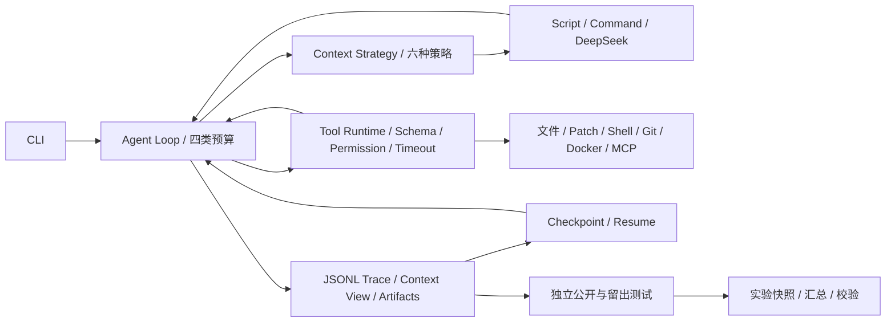

# Mini-dsh：可插拔 Coding Agent Harness

Mini-dsh 是 Python 3.11 的轻量级 Coding Agent Runtime。它把模型、上下文策略、工具、权限和会话事件拆开，支持自主多轮工具调用，并用独立测试评估代码任务。当前是单 Agent 原型；脚本模型用于确定性验证，不能代表真实模型能力。

## 架构



Agent Loop 的终态为 `finished`、`failed`、`cancelled`、`budget_exhausted`。Context 从原始事件生成每次模型调用实际看到的 View；原始事件保持独立。Tool Runtime 统一参数校验、权限、超时、结果和输出截断。评测器每次复制新的基线工作区，Agent 结束后才挂载留出测试。Agent 自报完成不算任务成功。

实现边界与证据见 [架构设计](docs/architecture.md)和[能力矩阵](docs/gap-matrix.md)。

## 安装与快速开始

```bash
uv sync --locked --dev
uv run --locked pytest
uv run --locked agent-harness run --task '读取 README 并概括项目' --script examples/readme_run.json --workspace .
```

项目使用 `uv.lock` 固定本地与 CI 的 Python 依赖。默认 Trace 在 `.runs/<run_id>/`，该目录被 Git 忽略。`uv run pytest` 仅收集仓库的 `tests/`，不会误收集任务基线中的公开测试。
GitHub Actions 除单元测试外还构建 Docker 镜像并运行六任务 × 六策略的确定性评测，随后校验 Trace、锚点及可搬运归档；该 CI 不调用 DeepSeek API。

真实模型使用 DeepSeek。在 `.env` 中设置 `DEEPSEEK_API_KEY`（参照 `.env.example`），或设置同名环境变量；环境变量优先。不要把密钥放进命令行、任务文件或 Git。价格随模型与时段变化，费用估算必须显式提供价格快照。无需额外 API；确定性任务只需要 Docker。

```bash
uv run --locked agent-harness run --task '读取 README 并概括项目' --deepseek --workspace .
uv run --locked agent-harness run --task '读取 README' --model-argv '["python","examples/bridge_model.py"]' --workspace .
```

`--deepseek-model` 指定模型；`--deepseek-pricing` 接收包含 `cache_hit`、`cache_miss`、`output` 的 JSON 美元/百万 Token 价格文件。未提供价格时费用是未知值。`--model-argv` 启动可信模型桥接进程，`--model-env` 指定透传环境变量名。脚本模型给出的 Token 用量是测试数据，不是提供方计费数据。
`--deepseek-max-output-tokens` 限制每次模型请求的生成量。批量评测可加 `--max-estimated-cost-usd`：启动前按价格快照、任务 Token 预算和输出上限计算保守估计，并逐次检查已估费用；这是本地估算防护，不是 DeepSeek 账单的硬上限。

## 工具与 Context

文件读写、Patch、Git、Shell、测试、构建与 MCP 统一经过 Tool Runtime。普通 `run` 的写入需 `--allow-writes`，Shell 还需 `--allow-command`；不传 `--docker-image` 时 Shell/测试/构建在宿主机运行。`eval` 默认用 Docker 执行测试命令。MCP stdio 配置示例在 `examples/mcp_servers.json`，MCP server 是宿主机可信进程。

普通 `run` 在启动和每次工具结果后保存工作区哈希检查点。进程中断后，可用相同模型、Context、工具、权限和预算参数执行 `resume --run-id <run_id> --script ... --workspace ...`；DeepSeek 可把 `--script` 换为 `--deepseek`。只有上次事件是完整检查点、工作区未变化且模型适配器可恢复时才继续。已完成的工具调用不会重跑；未确认结果的工具请求会记录 `unknown` 并以 `failed` 结束。外部模型桥接器当前不支持自动恢复。详见 [恢复机制](docs/resume.md)。

六种策略由 `--context` 选择：`full_history`、`sliding_window`、`summary`、`repository`、`retrieval_summary`、`python_symbols`。摘要是确定性摘录，仓库检索按词项匹配，Python 符号检索基于 AST；这三者目前都不是独立 LLM 检索或语义搜索服务。
[Context 策略说明](docs/context.md)记录每种 View 的保留、丢弃和索引刷新信息。

## 评测与实验

先准备 `coding-agent-sandbox:1` 镜像；下面的 Dockerfile 使用 Python 3.11，首次构建可能需要从镜像仓库下载基础镜像。Docker daemon 和当前用户对 socket 的权限必须可用。

```bash
docker build --provenance=false -t coding-agent-sandbox:1 -f benchmarks/Dockerfile .
uv run --locked agent-harness eval --manifest examples/eval_case.json --script examples/eval_fix.json
uv run --locked agent-harness eval-batch --plan benchmarks/plan.json --script-map benchmarks/scripts/map.json --output .runs/experiments/local-$(date +%s)
uv run --locked agent-harness experiment-verify .runs/experiments/<实验目录>
uv run --locked agent-harness experiment-seal .runs/experiments/<实验目录> docs/evidence/<名称>.json
uv run --locked agent-harness experiment-verify .runs/experiments/<实验目录> --anchor docs/evidence/<名称>.json
uv run --locked agent-harness experiment-export .runs/experiments/<实验目录> docs/evidence/<名称>.json .exports/<名称>.zip
uv run --locked agent-harness experiment-bundle-verify .exports/<名称>.zip --trusted-anchor docs/evidence/<名称>.json
uv run --locked agent-harness trace-verify .runs/<run_id>/trace.jsonl
uv run --locked agent-harness trace-diff --report .runs/<left>/trace.jsonl .runs/<right>/trace.jsonl
```

`benchmarks/` 包含六类小任务、公开开发测试、运行后才挂载的留出测试和固定脚本动作。`--script-map` 用于验证隔离、指标和完整性，结果不能用于比较策略能力。真实消融把 `--script-map ...` 换成 `--deepseek`，并设置 `--deepseek-pricing`、`--model-label`、固定任务集和足够重复次数；每次用新的输出目录。当前 DeepSeek 适配器不传 seed，重复运行也不保证确定性。详见 [评测协议](docs/evaluation.md)。

```bash
uv run --locked agent-harness eval-batch --plan benchmarks/real-plan.json --deepseek --deepseek-model deepseek-flash --deepseek-pricing benchmarks/pricing/deepseek-flash-peak-20261015.json --deepseek-max-output-tokens 4096 --max-estimated-cost-usd 1.0 --output .runs/experiments/real-$(date +%s)
```

运行前应重新核对价格快照与费用阈值；该命令会发起付费模型请求。
`eval` 与 `eval-batch` 在开始时把镜像标签解析为本地 `sha256:` 镜像 ID，后续所有容器都按该 ID 启动；Manifest 同时保存来源标签和实际 ID。镜像 ID 只证明本机容器字节一致，跨机器复现还需发布镜像或记录可拉取的仓库摘要。
`benchmarks/Dockerfile` 现将 Python 基础镜像固定到仓库摘要，构建命令关闭 provenance 元数据；本地重复构建得到相同镜像清单 ID。固定基础镜像的新确定性证据在 `.runs/experiments/pinned-base-20261015`，含输入快照的新版 ZIP 在 `.exports/pinned-base-with-inputs-20261015.zip`。离线镜像在 `.exports/coding-agent-sandbox-pinned-base-20261015.tar`，可用 `sha256sum -c docs/evidence/pinned-base-image.sha256` 检查后再 `docker load -i`。这些 `.exports/` 文件不进入 Git，需另行保存。
[Trace 差分](docs/trace-diff.md)可分别定位首次输入上下文差异和首次可观察行为差异。

实验保存 `manifest.json`、`runs.jsonl`、`summary.json` 和各次 Trace。Manifest 记录任务及基线哈希、模型配置摘要、Context 配置、权限和预算来源、价格快照、评测版本、运行状态与时间。完整性校验会重建指标，并检测缺失测试、Trace/记录不一致、输入源变化及不完整运行。它只能验证可见产物的一致性，不能防止能同时重写全部产物的攻击者。旧版实验仍可校验，但可能没有输入快照。
`experiment-seal` 在实验目录外写入 Manifest、结果和各运行文件的 SHA-256 清单；`experiment-verify --anchor` 同时校验文件字节和实验内部一致性。锚点必须单独保存或提交到可信版本库才能提供独立性；原始 `.runs/` 仍被 Git 忽略，需按访问控制要求另行保存。
`experiment-export` 将锚点、原始实验文件、任务 Manifest 和基线源码打成可搬运 ZIP；新版归档的验包器在临时目录复核输入快照哈希，旧版无输入文件的归档仍可验包，但 `inputs_checked` 为 0。`--trusted-anchor` 用单独保存的锚点检查 ZIP 内锚点。ZIP 默认放在被 Git 忽略的 `.exports/`；任务 Manifest 可能含留出测试断言，Trace 可能含模型输入和工具输出，必须按评测方敏感资料保存，不能放进 Agent 可访问的工作区。跨机器重新运行仍需相同的 Docker 镜像与模型服务。

离线费用重算不调用模型：

```bash
uv run --locked agent-harness reprice --experiment .runs/experiments/<实验目录> --pricing <价格快照.json> --pricing-model <模型名> --pricing-source <价格来源>
```

## 已有证据与限制

新实验 `.runs/experiments/real-context-20261015-b` 含 2 个任务 × 6 策略 × 3 次的 36 次真实 DeepSeek Flash 运行，27/36 次通过公开及留出测试，36 条 Trace 和独立文件锚点校验通过；其中 11 次出现供应商 HTTP 503，因此不能据此给策略排名。旧实验 `.runs/experiments/context-example-1d1b71fa` 含 1 个任务 × 6 策略 × 1 次真实运行，六次测试通过，但缺少输入快照。新固定镜像 ID 的确定性脚本实验 36/36 次通过，只证明评测链路工作。历史描述中的“24 次对照”“1,010 次离线执行”“10 次真实模型回归”及成本优化比例，没有对应的历史原始证据，不能作为本仓库结果。
[实验报告](docs/experiment-report.md)列出可复算的原始观察值和历史价格快照估算；[简历素材](docs/resume-material.md)仅使用已验证能力。

Docker 容器采用无网络、只读根文件系统、去能力、内存和进程限制，但共享宿主机内核，不能抵御所有恶意代码。宿主机 `run`、模型桥接和 MCP 进程只适用于可信配置。Trace 可能包含任务内容与工具输出；当前仅对配置的 API Key 做精确值脱敏。文件工具单次读写上限为 1 MB；单个子进程最多捕获 16 MiB 输出，单个 Session 的产物默认配额为 512 MiB。恢复只支持经过工作区哈希检查点的安全边界，不支持对结果不确定的工具调用自动重试。进一步边界见 [安全说明](docs/security.md)。

下一步优先扩大真实模型任务与重复次数、对恢复机制增加更强的工作区快照和故障注入、收紧宿主机与 MCP 的隔离；在此之前不对 Context 策略做性能排名。
