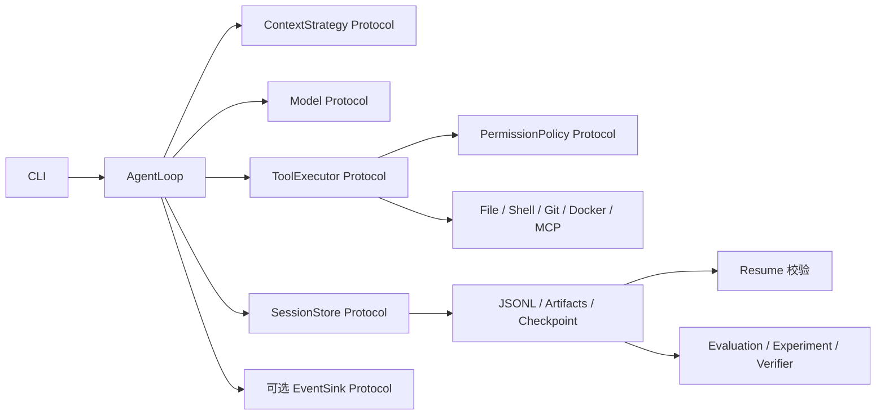

# Mini-dsh 架构

`AgentLoop` 通过构造函数接收模型、Context、工具执行器、会话和可选事件接收器。Session 的追加事件是执行事实；Context 策略只根据事件生成下一次模型调用视图，不会改写历史。模型可以在请求前用 `prepare_view` 规范化消息；Agent 记录规范化后的 View 和内容哈希，再传给模型。EventSink 失败会记入 Session 并停用该 Sink，主循环继续。

PluginGroup 提供独立的依赖拓扑排序、重复名/缺失依赖/循环检测、启动和逆序关闭。启动失败时也关闭正在初始化的插件。CLI 当前使用专门的 MCP 启动流程，通用 PluginGroup 没有对外提供动态插件加载入口。

工具调用经 `ToolRuntime` 的 Schema → Permission → Deadline → Execute → ToolResult。文件工具使用目录 FD 和 `O_NOFOLLOW`；宿主机 Shell、模型 bridge 和 MCP 进程的权限边界见 [安全说明](security.md)。`run` 的检查点和 [Resume](resume.md) 只允许从完整且工作区未变化的位置继续。

评测每次复制任务基线，公开测试与运行后挂载的留出测试由测试退出码决定结果。`experiment.py` 保存输入与配置快照、运行矩阵和汇总；`experiment_verify.py` 从 Trace 重建记录。实验完整性验证是内部一致性检查，不提供防篡改签名。
